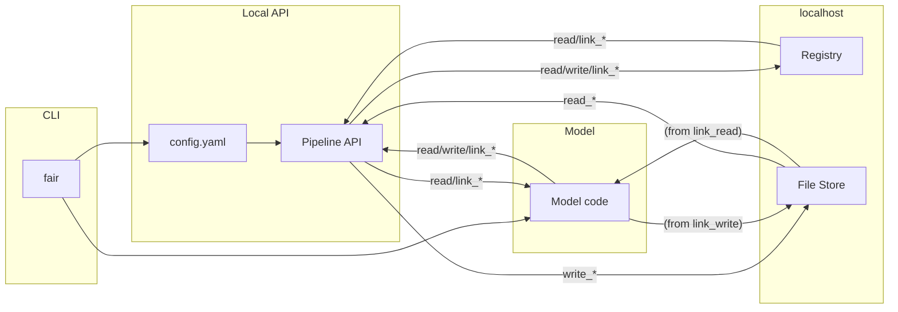
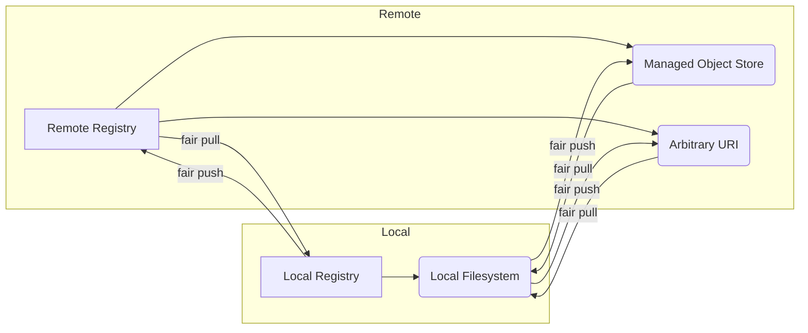

*Notice: This Documentation is in the process of being updated, some of the information may be out of date, or incorrect.*

# Introduction

The FAIR Data Pipeline is intended to enable tracking of provenance of [FAIR](https://doi.org/10.1038/sdata.2016.18) (findable, accessible, interoperable and reusable) data used in epidemiological modelling. Pipeline APIs written in [C](), [C++](), [FORTRAN](), [Java](), [Julia](), [Python]() and [R]() can be called by modelling software for data ingestion. These interact with a local relational database storing metadata and the local filesystem, and are configured using a yaml file associated with the model run. Local files and metadata can be synchronised with a remote registry via a command line interface ([`fair`]()).

The key benefits of using the FAIR Data Pipeline are:

- Opensource, all code is available on the [FAIRDataPipeline GitHub](https://github.com/FAIRDataPipeline)
- Data recorded in a FAIR fashion (metadata on all data and code open and available for inspection)
- Provenance tracing allows model outputs to be traced to inputs and modelling code
- Multiple language support
- Designed to run on a broad range of platforms (including HPC, inside Safe Havens)
- Designed to be set up and completed online (to down-/up-load data) and run offline (Safe Havens will require this)
- Open metadata provides knowledge of or access to shared central data for specific domains (e.g. COVID-19 epidemiological modelling)

## Running Models

To use the FAIR Data Pipeline with a piece of modelling software, you must add a language specific Pipeline API as a dependency and interact with data registered in the pipeline via the methods it presents. Each model run must be configured using a [`config.yaml`]() file which specifies inputs and outputs by metadata.

## Getting data

The command line interface [`fair`]() is used to download and upload data and metadata required for and produced by model runs.

