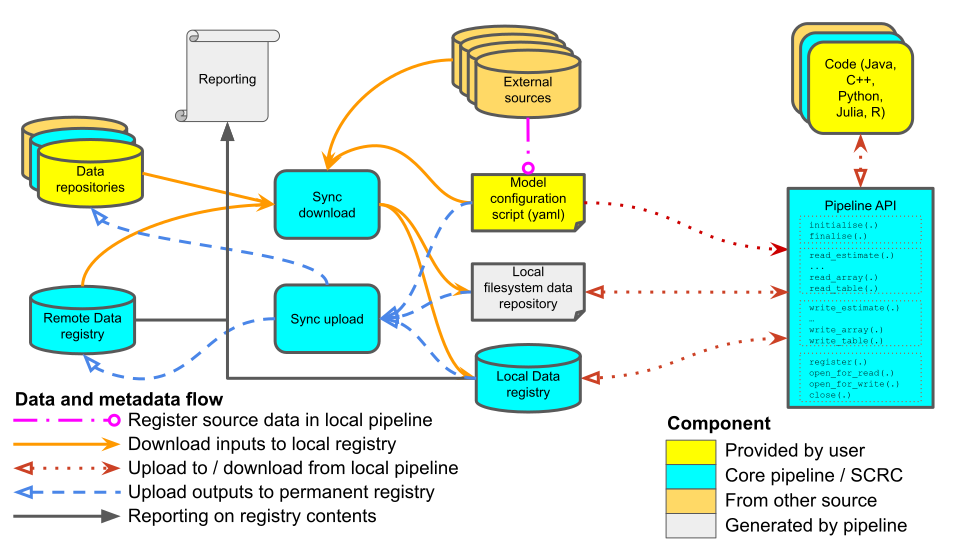

# FAIR CLI

The [FAIR CLI](https://github.com/FAIRDataPipeline/FAIR-CLI) (`fair`) is the main interface to the FAIR Data Pipeline. It is used to:

- set up a project (`fair init`) and install and manage the [local registry]() (`fair registry`)
- register and download the inputs a model run needs (`fair pull`)
- run models, recording each run and its inputs and outputs in the local registry (`fair run`)
- stage and synchronise results with a [remote registry]() (`fair add`, `fair push`)

See [Installation]() to get started and [FAIR CLI Commands]() for a description of each command.

## How a run works

A model run is configured by a user-written *config.yaml* file, which lists the data the run reads (`read:`), the data it writes (`write:`), data from outside the pipeline to register (`register:`) and the script to run (`run_metadata: script:` or `script_path:`). See the [CLI example]() for a complete config file.

1. `fair pull` reads the config file, registers anything listed under `register:` in the local registry and downloads it to the local data store. Data products listed under `read:` that exist on the remote registry are pulled locally.
2. `fair run` checks that the git repository holding the model code is clean and up to date with its remote, writes a *working config* (with variables, wildcards and versions resolved) and the submission script to a new folder in the data store, and runs the script. The script is told where that folder is by the `FDP_CONFIG_DIR` environment variable, and is given the local registry's token in `FDP_LOCAL_TOKEN`.
3. The model calls a [language API](), which reads the working config and records the *code run* in the local registry: the code repository and commit, the config file, the submission script, and every file read or written.
4. `fair add` stages the code runs and data products to share, and `fair push` uploads their metadata to the remote registry and their files to its object store.

The local registry can be browsed at any time to inspect what has been recorded, including a [provenance report]() for each data product.
