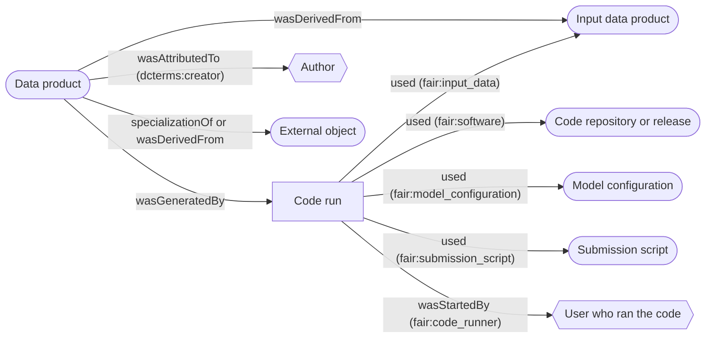

# Provenance Report

To address the [use case]() of tracing reported results back to the evidence behind them, the data registry can produce a provenance report for each data product.

Provenance is the documented history of the processes in a digital object's lifecycle. The registry's reports use the [PROV Ontology](https://www.w3.org/TR/prov-o/) (PROV-O), which describes provenance in terms of:

- **entities**: things, such as data products, external sources, code, configurations and scripts
- **activities**: things that happened, here code runs
- **agents**: the people and organisations responsible, here authors and the users who ran the code

Provenance reports are available for `DataProduct`s through the REST API, at `api/prov-report/<id>/` where `<id>` is the data product's id, *e.g.*:

```
https://data.fairdatapipeline.org/api/prov-report/3/
```

Each data product's API record also links to its report in its `prov_report` field.

## Formats

The format is chosen with the `format` query parameter (*e.g.* `?format=provn`) or the request's `Accept` header:

| `format` | Description | Media type |
| --- | --- | --- |
| `api` | the report in the registry's browsable API page (default in a browser) | `text/html` |
| `json` | [PROV-JSON](https://www.w3.org/submissions/prov-json/) | `application/json` |
| `json-ld` | JSON-LD | `application/ld+json` |
| `xml` | [PROV-XML](https://www.w3.org/TR/prov-xml/) | `text/xml` |
| `provn` | [PROV-N](https://www.w3.org/TR/prov-n/) | `text/provenance-notation` |
| `jpg` | an image of the provenance graph | `image/jpeg` |
| `svg` | an image of the provenance graph, with links | `image/svg+xml` |

The `jpg` and `svg` formats are only offered if [Graphviz](https://graphviz.org/download/) was installed on the registry's machine when the registry started.

## Query parameters

| Parameter | Description |
| --- | --- |
| `depth` | how many levels of code runs to include (default `1`): each further level adds the provenance of the previous level's inputs, and a data product reached by several routes is expanded once |
| `attributes` | `False` hides the attributes of each element in the images (shown by default) |
| `aspect_ratio` | the ratio of the images' height to width (default `0.71`, A4 landscape) |
| `dpi` | the resolution of the images |

For example, `api/prov-report/3/?format=svg&depth=2&attributes=False`.

## What a report contains

A report for a data product written by a code run, with `depth=1`, has this shape (each element with its PROV relationship, and in brackets the role where there is one):



### Entities

- **Data products** (`dcat:Dataset`): the namespace (`fair:namespace`), name (`dcterms:title`) and version (`dcat:hasVersion`), the location (`prov:atLocation`) and SHA-1 hash (`fair:hash`) of the file, its description, file type (`dcterms:format`), when it was last modified, and any issues raised against it (`fair:issue`, with the issue's description, severity and id).
- **External objects** (`dcat:Dataset`): the source a data product was registered from, with its title, version, release date (`dcterms:issued`), identifier or alternate identifier and type, description and original location. A data product registered from a primary source is a `specializationOf` the external object; one registered from a supplementary source `wasDerivedFrom` it.
- **Code repositories**: the location of the code and the commit that was run (`fair:commit`). A code repository that is a `CodeRepoRelease` is a `dcmitype:Software` with its name, version and website.
- **Model configurations** and **submission scripts**: the working *config.yaml* and the script of each code run, with their location, hash, description and file type. A submission script is a `dcmitype:Software`.

The authors of each of these entities are attached with `wasAttributedTo`, in the role `dcterms:creator`.

### Activities

- **Code runs** (`fair:Run`): with the run's description and its start time. A data product `wasGeneratedBy` the code run that wrote it, and `wasDerivedFrom` each data product that code run read.

### Agents

- **Authors** (`prov:Person` or `prov:Organization`): with their name (`foaf:name`) and identifier, such as an ORCID or ROR ID.
- **The user who ran the code**: the author linked to the user who recorded the code run, or the user if they have no linked author. A code run `wasStartedBy` them, in the role `fair:code_runner`.

### Labels and issues

Every element has a `prov:label` naming it, which the images use:

- a data product as `<namespace>:<name>@<version>`
- an external object or code release as `<title> (<version>)`
- a code run as `<description> (<date>)`
- an agent by name
- a model configuration or submission script by its role, and a code repository by its location

In the images, elements with issues have their `fair:issue` attributes highlighted in red.

## Prefixes

All activities, agents and entities have a URI, written with a prefix for the registry that holds them: `reg` for the central registry (https://data.fairdatapipeline.org/) and `lreg` for any other registry, such as a local registry. Depending on where the report was produced you may see:

```
reg:api/data_product/1
```

or

```
lreg:api/data_product/1
```

The other prefixes are for the vocabularies used. In PROV-N, for a local registry, these are:

```
prefix lreg <http://127.0.0.1:8000/>
prefix fair <https://data.fairdatapipeline.org/vocab/#>
prefix dcat <http://www.w3.org/ns/dcat#>
prefix dcmitype <http://purl.org/dc/dcmitype/>
prefix dcterms <http://purl.org/dc/terms/>
prefix foaf <http://xmlns.com/foaf/spec/#>
prefix rdf <http://www.w3.org/1999/02/22-rdf-syntax-ns#>
```

The `fair` terms (such as `fair:Run`, `fair:namespace` and `fair:code_runner`) are defined on the central registry's [vocabulary page](https://data.fairdatapipeline.org/vocab/), and each registry serves the same list at `vocab/`.

## Examples

These reports were produced by a local registry loaded with the registry's example data (`python manage.py add_example_data`), which holds the SEIRS model used in the [CLI examples]().

### A data product registered from an external source

The model's parameters, registered with `register:` from a primary source, are a `specializationOf` the source. As an image (`api/prov-report/1/?format=svg`):


and in PROV-N (`api/prov-report/1/?format=provn`):

```
document
  prefix lreg <http://127.0.0.1:8000/>
  prefix fair <https://data.fairdatapipeline.org/vocab/#>
  prefix dcat <http://www.w3.org/ns/dcat#>
  prefix dcmitype <http://purl.org/dc/dcmitype/>
  prefix dcterms <http://purl.org/dc/terms/>
  prefix foaf <http://xmlns.com/foaf/spec/#>
  prefix rdf <http://www.w3.org/1999/02/22-rdf-syntax-ns#>
  
  entity(lreg:api/data_product/1, [rdf:type='dcat:Dataset', dcterms:modified="2026-11-09T16:43:49.300889+00:00" %% xsd:dateTime, prov:atLocation="file:///Users/user_home/.fair/data/PSU/SEIRS_model/parameters/1.0.0.csv", fair:hash="6294a5951677e6b8438cabf55234b7974adeaee3", dcterms:description="Static parameters of the model", fair:namespace="PSU", dcterms:title="SEIRS_model/parameters", dcat:hasVersion="1.0.0", dcterms:format="Comma-Separated Values File", prov:label="PSU:SEIRS_model/parameters@1.0.0"])
  agent(lreg:api/author/1, [rdf:type='prov:Person', foaf:name="Author 1", prov:label="Author 1"])
  wasAttributedTo(lreg:api/data_product/1, lreg:api/author/1, [prov:role='dcterms:creator'])
  entity(lreg:api/external_object/1, [rdf:type='dcat:Dataset', dcterms:title="Static parameters of the model", dcterms:issued="2021-09-20T12:00:00+00:00" %% xsd:dateTime, dcat:hasVersion="1.0.0", dcterms:identifier="https://doi.org/10.1038/s41592-020-0856-2", fair:alternate_identifier="SEIRS model parameters - Static parameters of the model", fair:alternate_identifier_type="SEIRS_model_params", prov:label="Static parameters of the model (1.0.0)"])
  specializationOf(lreg:api/data_product/1, lreg:api/external_object/1)
endDocument
```

### A data product generated by a code run

The results of the Python model are generated by a code run, which used the code release, the working config, the submission script and the parameters above. As an image, with the attributes hidden (`api/prov-report/7/?format=svg&attributes=False`):


and in PROV-N (`api/prov-report/7/?format=provn`):

```
document
  prefix lreg <http://127.0.0.1:8000/>
  prefix fair <https://data.fairdatapipeline.org/vocab/#>
  prefix dcat <http://www.w3.org/ns/dcat#>
  prefix dcmitype <http://purl.org/dc/dcmitype/>
  prefix dcterms <http://purl.org/dc/terms/>
  prefix foaf <http://xmlns.com/foaf/spec/#>
  prefix rdf <http://www.w3.org/1999/02/22-rdf-syntax-ns#>
  
  entity(lreg:api/data_product/7, [rdf:type='dcat:Dataset', dcterms:modified="2026-11-09T16:43:49.593547+00:00" %% xsd:dateTime, prov:atLocation="file:///Users/user_home/.fair/data/SEIRS_model/results/model_output/python/f94100af31fb54b5cdfaa22b31eadbad13c9e633.csv", fair:hash="f94100af31fb54b5cdfaa22b31eadbad13c9e633", dcterms:description="SEIRS model results", fair:namespace="user_4", dcterms:title="SEIRS_model/results/model_output/python", dcat:hasVersion="0.0.1", dcterms:format="Comma-Separated Values File", prov:label="user_4:SEIRS_model/results/model_output/python@0.0.1"])
  agent(lreg:api/author/1, [rdf:type='prov:Person', foaf:name="Author 1", prov:label="Author 1"])
  wasAttributedTo(lreg:api/data_product/7, lreg:api/author/1, [prov:role='dcterms:creator'])
  activity(lreg:api/code_run/4, 2021-10-07T12:15:54.842457+00:00, -, [rdf:type='fair:Run', dcterms:description="SEIRS Model python", prov:label="SEIRS Model python (2021-10-07)"])
  wasGeneratedBy(lreg:api/data_product/7, lreg:api/code_run/4, -)
  agent(lreg:api/author/3, [rdf:type='prov:Person', foaf:name="Author 3", prov:label="Author 3"])
  wasStartedBy(lreg:api/code_run/4, lreg:api/author/3, -, 2021-10-07T12:15:54.842457+00:00, [prov:role='fair:code_runner'])
  entity(lreg:api/code_repo_release/4, [rdf:type='dcmitype:Software', dcterms:modified="2026-11-09T16:43:49.588383+00:00" %% xsd:dateTime, prov:atLocation="https://github.com/FAIRDataPipeline/pythonFDP.git", fair:commit="5990e80e3e6f0cd6d81e702926518ae16fa18e88", dcterms:description="Analysis / processing script location", dcterms:title="pythonFDP", dcat:hasVersion="1.0.0", fair:website="https://github.com/", prov:label="pythonFDP (1.0.0)"])
  wasAttributedTo(lreg:api/code_repo_release/4, lreg:api/author/1, [prov:role='dcterms:creator'])
  used(lreg:api/code_run/4, lreg:api/code_repo_release/4, -, [prov:role='fair:software'])
  entity(lreg:api/object/16, [dcterms:modified="2026-11-09T16:43:49.550832+00:00" %% xsd:dateTime, prov:atLocation="file:///Users/user_home/.fair/data/jobs/2021-10-07_12_15_53_596966/config.yaml", fair:hash="012fc266f39697d42a6926af2b145e965cce335b", dcterms:description="Working config.yaml location in datastore", dcterms:format="YAML Document", prov:label="model configuration"])
  wasAttributedTo(lreg:api/object/16, lreg:api/author/1, [prov:role='dcterms:creator'])
  used(lreg:api/code_run/4, lreg:api/object/16, -, [prov:role='fair:model_configuration'])
  entity(lreg:api/object/17, [rdf:type='dcmitype:Software', dcterms:modified="2026-11-09T16:43:49.561545+00:00" %% xsd:dateTime, prov:atLocation="file:///Users/user_home/.fair/data/jobs/2021-10-07_12_15_53_596966/script.sh", fair:hash="8888514380fa211b0c1869059316652e2ead3dd7", dcterms:description="Working script location in datastore", dcterms:format="Python Script", prov:label="submission script"])
  wasAttributedTo(lreg:api/object/17, lreg:api/author/1, [prov:role='dcterms:creator'])
  used(lreg:api/code_run/4, lreg:api/object/17, -, [prov:role='fair:submission_script'])
  entity(lreg:api/data_product/1, [rdf:type='dcat:Dataset', dcterms:modified="2026-11-09T16:43:49.300889+00:00" %% xsd:dateTime, prov:atLocation="file:///Users/user_home/.fair/data/PSU/SEIRS_model/parameters/1.0.0.csv", fair:hash="6294a5951677e6b8438cabf55234b7974adeaee3", dcterms:description="Static parameters of the model", fair:namespace="PSU", dcterms:title="SEIRS_model/parameters", dcat:hasVersion="1.0.0", dcterms:format="Comma-Separated Values File", prov:label="PSU:SEIRS_model/parameters@1.0.0"])
  entity(lreg:api/external_object/1, [rdf:type='dcat:Dataset', dcterms:title="Static parameters of the model", dcterms:issued="2021-09-20T12:00:00+00:00" %% xsd:dateTime, dcat:hasVersion="1.0.0", dcterms:identifier="https://doi.org/10.1038/s41592-020-0856-2", fair:alternate_identifier="SEIRS model parameters - Static parameters of the model", fair:alternate_identifier_type="SEIRS_model_params", prov:label="Static parameters of the model (1.0.0)"])
  specializationOf(lreg:api/data_product/1, lreg:api/external_object/1)
  wasAttributedTo(lreg:api/data_product/1, lreg:api/author/1, [prov:role='dcterms:creator'])
  used(lreg:api/code_run/4, lreg:api/data_product/1, -, [prov:role='fair:input_data'])
  wasDerivedFrom(lreg:api/data_product/7, lreg:api/data_product/1, -, -, -)
endDocument
```
